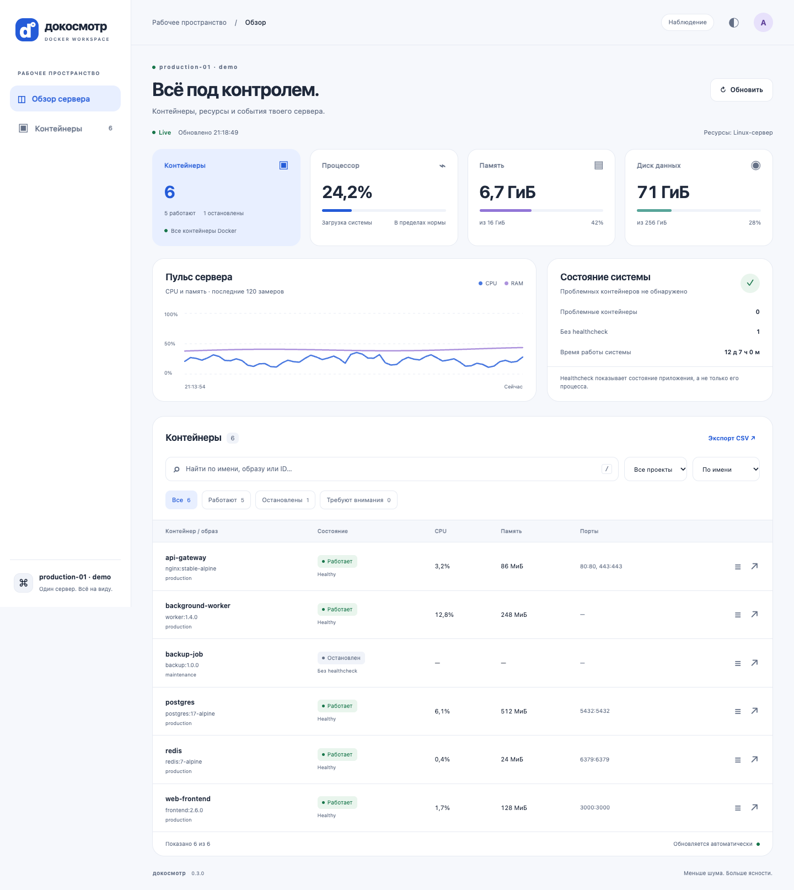

# Докосмотр

Лёгкая панель мониторинга **всех контейнеров одного Docker Engine**: работающих,
остановленных, приостановленных и перезапускающихся. Обновление Docker Dashboard
v0.2.5 с сохранением основы: **Flask + Socket.IO + Docker CLI + HTML/CSS/JS**.
Без React, сборки фронтенда и отдельной базы данных.



На иллюстрации — демонстрационные данные, а не доступ к реальному серверу.
[Тёмная тема](docs/dashboard-dark.png) · [Мобильная версия](docs/mobile.png)

## Что есть

- Интерфейс в духе Material Design: светлая/тёмная тема, мобильная версия, клавиатурная навигация.
- CPU, память, сеть, дисковый I/O и число процессов контейнеров; Docker healthcheck и перезапуски.
- Поиск по имени/образу/ID, фильтры состояния и Compose-проекта, сортировка, CSV текущего списка.
- CPU/RAM системы, занятое место файловой системы данных, uptime, последние 120 замеров.
- Логи stdout + stderr, 200/500/2000 строк, скачивание файла.
- Роли `viewer` и `admin`. Управление start/stop/restart включается отдельно.
- Явное отображение недоступности Docker и устаревших данных, восстановление связи.
- Один фоновый сборщик для всех вкладок; один вызов `docker stats` на цикл, пакетный `inspect`.

## Быстрый запуск на Linux

Нужны Docker Engine, Compose v2, Git и доступ пользователя к Docker.
Сервер сам не устанавливается и чужие контейнеры не перезапускаются.

```bash
git clone https://github.com/f1g4r/dokosmotr.git
cd dokosmotr
git checkout v0.3.1
./install.sh
```

Установщик создаст `.env`, определит группу Docker-сокета, соберёт образ и запросит
**новый пароль администратора длиной от 14 символов**. Общих паролей нет.
Если `.env` и пользователи уже существуют, они сохраняются. Данные лежат в named volume.
Приложение и Docker CLI запускаются от UID 10001, без Linux capabilities, с файловой системой read-only.

По умолчанию порт `5080` опубликован на сетевых интерфейсах сервера.
На любом ПК в той же сети открой **`http://IP-СЕРВЕРА:5080`**. Установщик выведет
адреса сервера. IP, домен и внешний порт не нужно вписывать в приложение:
вход, CSRF и WebSocket используют тот же адрес, который открыт в браузере.

### Обновление установленной v0.3.0 для доступа из сети

```bash
git fetch origin --tags
git checkout v0.3.1
./install.sh --lan
```

`--lan` меняет только сетевые настройки: включает `0.0.0.0`, автоматический origin
и HTTP-cookie. Твой порт, пользователи, пароли и том данных сохраняются.
Если проект скачан архивом, распакуй новый релиз в папку проекта и запусти
`./install.sh --lan`. Новый проект работает в сети без флагов.

Для доступа только с сервера есть `./install.sh --local`.
Если используешь HTTPS-прокси с `PUBLIC_ORIGIN`, обычное обновление `./install.sh`
сохранит его конфигурацию; `--lan` предназначен для прямого HTTP-доступа в сети.

Если TCP-порт ограничен сетевым экраном сервера, разреши входящий TCP на выбранный
порт для своей сети. Установщик не отключает firewall и не меняет правила сети.

Не открывай Docker TCP-порт 2375. Панели достаточно Unix-сокета.

## Ручной запуск / macOS

```bash
cp .env.example .env
# Linux: укажи DOCKER_GID, полученный командой stat -c '%g' /var/run/docker.sock
# Для rootless Docker укажи также DOCKER_SOCKET и его группу.
docker compose -p dokosmotr build
docker compose -p dokosmotr run --rm docker-dashboard python app.py user --username admin --role admin
docker compose -p dokosmotr up -d --wait
```

На Linux можно добавить `-f docker-compose.yml -f compose.linux.yml` ко всем
командам Compose: это подключает `/proc` хоста только для чтения, чтобы CPU/RAM/uptime
относились к Linux-серверу. **Метрики всех контейнеров работают и без этого файла.**
На Docker Desktop системные показатели относятся к Linux VM, а не к macOS.
«Диск данных» показывает файловую систему тома `/app/data`, не сумму дисков сервера.

## Настройки `.env`

| Переменная | По умолчанию | Назначение |
|---|---|---|
| `PORT` | `5080` | Свободный локальный порт |
| `BIND_ADDRESS` | `0.0.0.0` | Сетевые интерфейсы; `127.0.0.1` для локального доступа |
| `PUBLIC_ORIGIN` | пусто | Автоматически из адреса браузера; можно задать точный origin для HTTPS-прокси |
| `COOKIE_SECURE` | `false` | Для HTTPS обязательно `true` |
| `READ_ONLY` | `true` | Запрет start/stop/restart даже для admin |
| `DOCKER_GID` | `0` | Числовая группа Docker-сокета |
| `DOCKER_SOCKET` | `/var/run/docker.sock` | Путь к сокету на хосте |
| `SERVER_LABEL` | `Docker server` | Название сервера в интерфейсе |
| `UPDATE_INTERVAL` | `5` | Пауза между циклами, минимум 3 секунды |
| `SESSION_TTL` | `28800` | Абсолютный срок сессии, 8 часов |

Каждый цикл занимает дополнительное время на Docker CLI. История ограничена 120
снимками и сбрасывается при перезапуске приложения. CPU контейнера может быть больше
100% при использовании нескольких ядер; CPU системы нормализован до 100%.

### Пользователи и управление

```bash
# Создать наблюдателя или сменить пароль существующего пользователя:
docker compose -p dokosmotr run --rm docker-dashboard python app.py user --username observer --role viewer
docker compose -p dokosmotr restart docker-dashboard
```

После смены пользователя/пароля обязателен перезапуск. Он также отзывает все сессии.
Пароль вводится скрыто, хранится только scrypt-хеш в `/app/data/users.json` с правами 0600.
Для автоматизации есть `--password-stdin`; не передавай пароль аргументом командной строки.
Чтобы включить управление, установи `READ_ONLY=false` в `.env` и выполни `up -d`.
Роль viewer всё равно не сможет управлять контейнерами. Собственный контейнер панели
защищён от остановки. Удаление контейнеров, shell/exec и создание привилегированных
контейнеров через интерфейс отсутствуют.

### HTTPS и доступ через домен

Используй TLS reverse proxy на сервере; пример для Caddy:

```caddyfile
docker.example.com {
    reverse_proxy 127.0.0.1:5080
}
```

В `.env`: `PUBLIC_ORIGIN=https://docker.example.com`, `COOKIE_SECURE=true`.
Установи `BIND_ADDRESS=127.0.0.1`, если прокси работает на самом сервере. Прокси должен поддерживать WebSocket.
Прямой HTTP-доступ в локальной сети поддерживается без отдельной настройки origin. `X-Forwarded-For` не считается
доверенным: за прокси ограничение входов применяется к адресу прокси. Для большой
команды добавь внешний rate limit; не включай слепое доверие forwarded-заголовкам.

## Обновление из публичного репозитория

Обновления выполняются явно: автоматического скачивания и исполнения кода нет.

```bash
git fetch --tags origin
# Сначала прочитай заметки нужного релиза. Локальные изменения не затираются.
git checkout v0.3.1
./install.sh
```

Замени тег на нужный релиз. При запуске из архива можно скачать архив нового релиза
в отдельную папку, перенести `.env` и выполнить `./install.sh`. Имя Compose-проекта
`dokosmotr` сохраняет существующий named volume независимо от папки checkout.
Не используй `docker compose down -v`, если хочешь сохранить пользователей и аудит.
Перед обновлением сделай резервную копию:

```bash
mkdir -p backups
chmod 700 backups
docker compose -p dokosmotr run --rm -T --no-deps docker-dashboard \
  tar czf - -C /app/data . > backups/dokosmotr-data.tar.gz
chmod 600 backups/dokosmotr-data.tar.gz
```

Копия содержит хеши паролей и аудит. Не добавляй её в Git и не публикуй.
Для отката выбери прежний совместимый тег и повтори `./install.sh`.

## Разработка и проверки

Основные файлы:

```text
app.py                    Flask API, сессии, сбор метрик, CLI пользователей
frontend/css/style.css    темы, адаптивная сетка, компоненты
frontend/js/              DOM-рендеринг, вход, WebSocket + HTTP fallback
frontend/vendor/          локальный клиент Socket.IO и его лицензия
docker-compose.yml        базовый запуск, ограничения контейнера
compose.linux.yml         необязательные системные метрики Linux
requirements.lock         зафиксированные Python-зависимости
install.sh                повторяемая установка без удаления данных
tests/                    API/security/collector + браузерные сценарии
```

```bash
docker build -t dokosmotr:local .
docker run --rm -v "$PWD/tests:/app/tests:ro" \
  -v "$PWD/install.sh:/app/install.sh:ro" -v "$PWD/.env.example:/app/.env.example:ro" dokosmotr:local \
  python -m unittest discover -s tests -v

# Веб-тесты против локального тестового экземпляра:
npm ci
npx playwright install chromium
TEST_URL=http://127.0.0.1:5080 TEST_USERNAME=admin TEST_PASSWORD='test-only-password' npm test
```

Node нужен только для браузерных тестов. Flask запускается Gunicorn с **одним worker**:
сессии, ограничение входов и сборщик находятся в памяти процесса. Увеличивай threads,
а не workers. Несколько workers требуют общего хранилища сессий/лимитов и отдельного
сборщика, это намеренно не включено в простую архитектуру.

GitHub Actions запускает API-тесты, реальный Docker smoke/browser test, проверку
Python-зависимостей на известные уязвимости. Dependabot предлагает обновления.
Как обновить lock-файл: [CONTRIBUTING.md](CONTRIBUTING.md).

## Ограничения и безопасность

**Docker-сокет даёт процессу панели широкие права на хосте.** Режим READ_ONLY — запрет
в HTTP API, а не изоляция самого сокета. Даже `:ro` на Unix-сокете не ограничивает
команды Docker. Не считай эту панель границей безопасности между недоверенными
пользователями. Подробности и модель угроз: [SECURITY.md](SECURITY.md).

Это один сервер, не Swarm/Kubernetes и не система долговременного хранения метрик.
Логи могут содержать секреты приложений; выдавай роль viewer только тем, кому можно
читать журналы всех контейнеров. Ресурсы/образы и состояние берутся из реального
Docker, демонстрационные данные в продукт не подмешиваются.

Происхождение исходников и сторонние компоненты: [NOTICE.md](NOTICE.md).
